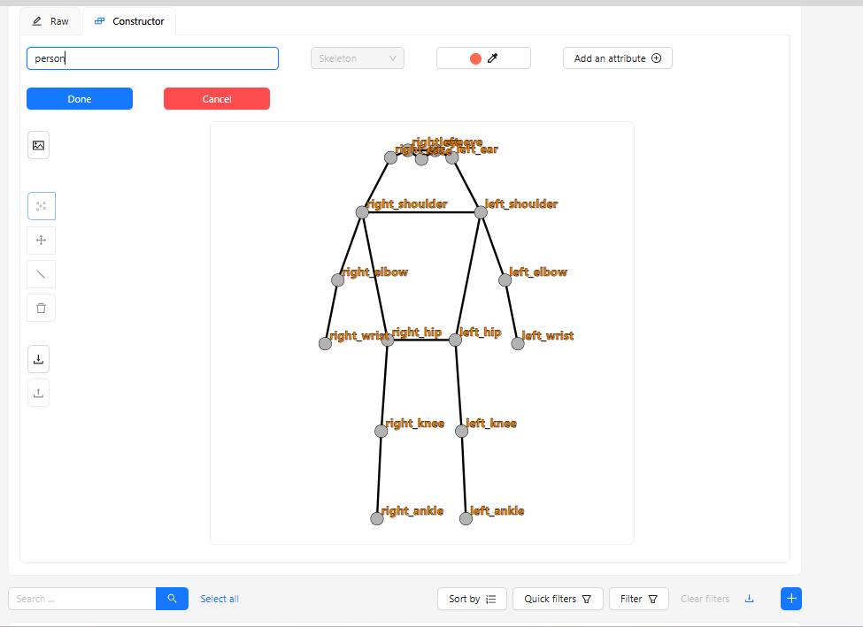
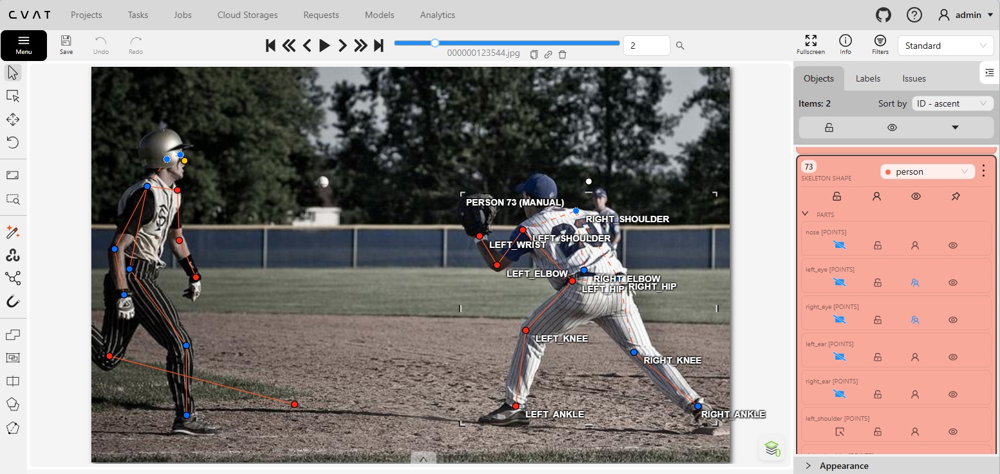
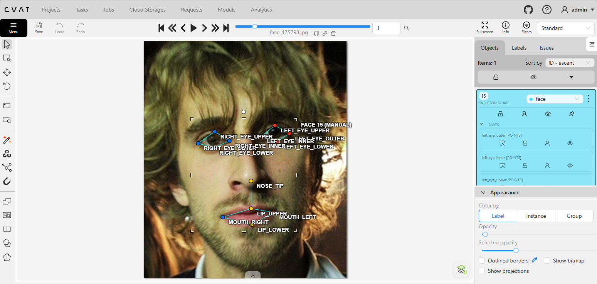
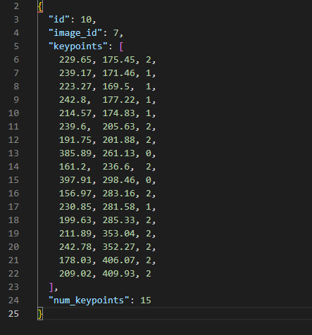

# Báo cáo cá nhân — HoVaTen-MSSV

Đổi tên file theo quy tắc `MSSV_HoTen.md`. Ví dụ: `20241234_NguyenVanAn.md`.

Dữ liệu: 12 ảnh người COCO val2017 (Lin et al., 2014) và 8 ảnh chân dung Wikimedia Commons, chỉ dùng trong lớp.

## 0. Thông tin học viên

- Họ tên: Nguyễn Khánh Trình
- MSSV: 2A202603026
- Email: 26ai.trinhnk@vinuni.edu.vn
- Link repository: https://github.com/khanhtrinhkt2014/K5-L2-DAY04-NguyenKhanhTrinh-2A202603026-KeypointPose.git
- Phiên bản CVAT (Help → About):2.82.1
- Máy: hệ điều hành Win11 · RAM 64 GB · chạy CVAT chế độ đầy đủ 
- Bộ ảnh (`src/exports/assignment.json` do `lab.py setup` tạo): có
- Giờ bắt đầu: 17h
- Giờ kết thúc:18h30

## 1. Kiểm tra label (CP0)

| Label | Kiểu | Số điểm | Tên điểm đúng bảng của lab? | Đúng thứ tự? | Số cạnh |
|---|---|---:|---|---|---:|
| `person` | Skeleton | 17 | Có | Có | 19 |
| `face` | Skeleton | 13 | Có | Có | 13 |

Mẫu `person` dựng theo người quay mặt về camera (các điểm `left_*` nằm bên phải khung mẫu)? Có

Cách đổi cờ `occluded` / `outside` cho **một điểm** trên phiên bản CVAT này (một câu):

Rê chuột vào đúng điểm rồi nhấn `Q` để bật/tắt `occluded` hoặc `O` để bật/tắt `outside`.

## 2. Số lượng đã gán và thời gian (CP1, CP2)

| Nhóm ảnh | Số ảnh | Số skeleton đã gán | Số người dưới 60 px (không gán) | Số poster / gương / màn hình bỏ qua | Thời gian (phút) |
|---|---:|---:|---:|---:|---:|
| `easy` | 5 | 7 | | | 10 |
| `occluded` | 3 | 3 | | | 15 |
| `back` | 3 | 6 | | | 30 |
| `small` | 0 | 0 | | | 15 |
| `crowd` | 1 | 2 | | | 10 |
| `faces` | 8 | 8 | — | | 10 |

- Số ảnh người đã xong ở mốc phút 105: 12 / 12
- Thời gian thực tế (phút): CP1 30 · CP2 30 · CP3 30
- Ảnh tốn thời gian nhất là ảnh nào, vì sao?

Ảnh 000000091637.jpg (nhóm occluded) tốn nhiều thời gian nhất. Em bé quay lưng về phía camera, nên tôi mất thêm thời gian để xác định trái/phải theo cơ thể em và phân biệt điểm bị che nhưng vẫn ước lượng được vị trí (v = 1) với điểm không thể xác định đủ chắc (v = 0).

## 3. Bảng ca khó (CP1, CP2)

Mỗi điểm bạn phân vân một dòng, nhất là phân vân giữa `v = 1` và `v = 0`, hoặc không chắc hướng người.

| Ảnh | Người / mặt | Điểm | Cờ đã chọn | Phân vân giữa | Lý do chọn |
|---|---|---|---|---|---|
| `000000091637.jpg` | Em bé quay lưng | `left_eye` | `v = 0` | `v = 0` và `v = 1` | vì không xác định được vị trí |
| `000000091637.jpg` | Em bé quay lưng | `right_eye` | `v = 0` | `v = 0` và `v = 1` | vì không xác định được vị trí |
| `000000091637.jpg` | Em bé quay lưng | `nose` | `v = 0` | `v = 0` và `v = 1` | vì không xác định được vị trí |

## 4. Bảng tự review (CP3)

Đi từ ảnh cuối về ảnh đầu. 5 ảnh người (ít nhất 2 ảnh `back` hoặc `crowd`) và 3 ảnh mặt. Ít nhất 8 dòng, kể cả dòng `ok`. Ghi lỗi trước, sửa sau.

Mã lỗi dùng đúng một trong: `lr_swap`, `vis_flag`, `position`, `missing`, `extra`, `ok`.

| Ảnh | Người / mặt | Điểm | Mã lỗi | Ghi chú | Đã sửa? |
|---|---|---|---|---|---|
| `000000381889.jpg` (`crowd`) | Các người trong ảnh | Số skeleton | `missing` | Kiểm người đội mũ đen cầm điện thoại đã có skeleton chưa | Chưa |
| `000000480582.jpg` (`back`) | Hai người chăn cừu | Các cặp trái/phải | `ok` | Kiểm trái/phải theo hướng từng người | `ok` |
| `000000123544.jpg` (`back`) | Người #1 theo log | `left_wrist`, `right_wrist` | `ok` | Script cảnh báo cặp cổ tay. Lần từ vai qua khuỷu đến cổ tay | `ok` |
| `000000123544.jpg` (`back`) | Người #2 theo log | `left_knee`, `right_knee` | `ok` | Script cảnh báo cặp đầu gối. Lần từ hông xuống gối | `ok` |
| `000000343057.jpg` (`easy`) | Người #1 theo log | Hai gối, hai cổ chân | `ok` | Script cảnh báo cặp gối và cổ chân. Lần theo từng chân từ hông xuống | `ok` |
| `000000019754.jpg` (`easy`) | Người #1 theo log | `left_wrist`, `right_wrist` | `ok` | Script cảnh báo cặp cổ tay. Kiểm tên điểm theo cánh tay | `ok` |
| `face_175798.jpg` | Mặt #1 | Mắt, mũi, miệng | `ok` | Kiểm vị trí và cờ của các điểm | `ok` |
| `face_99874.jpg` | Mặt #1 | Mắt, mũi, miệng | `ok` | Kiểm vị trí và cờ của các điểm | `ok` |
| `face_504911.jpg` | Mặt #1 | Mắt, mũi, miệng | `ok` | Kiểm vị trí và cờ của các điểm | `ok` |

Tổng hợp số lỗi theo mã:

| `lr_swap` | `vis_flag` | `position` | `missing` | `extra` | `ok` |
|---:|---:|---:|---:|---:|---:|
| | | | | | |

Điểm còn phân vân giữa `v = 1` và `v = 0` (ghi cả hai lựa chọn và lý do chọn):

Trong ảnh 000000091637.jpg, tôi phân vân giữa v = 1 và v = 0 cho hai mắt (left_eye, right_eye) và mũi (nose) của em bé. Vì em bé quay lưng về phía camera, tôi không thấy mắt và mũi, cũng không có đủ dấu hiệu để ước lượng chắc vị trí của từng điểm. Tôi chọn v = 0 (outside) cho cả ba điểm.

## 5. Kiểm file xuất và kết quả tự kiểm (CP4)

Tự kiểm tay trong file JSON:

| File | Người / mặt kiểm (ảnh, thứ tự) | Số phần tử `keypoints` | Điểm `outside` ra `v = 0`, `occluded` ra `v = 1`? | `num_keypoints` khớp? |
|---|---|---:|---|---|
| `NguyenKhanhTrinh_persons.zip` | `000000019754.jpg`, người #1 | 51 | 	Không có điểm v = 0. Có 4 điểm v = 1, ví dụ left_ear | Có. 4 điểm v = 1 + 13 điểm v = 2 = 17. JSON ghi 17. |
| `NguyenKhanhTrinh_persons.zip` | `000000343057.jpg`, người #1 | 51 | left_elbow và left_wrist có v = 0. Có 5 điểm v = 1, ví dụ left_eye. | Có. 5 điểm v = 1 + 10 điểm v = 2 = 15. JSON ghi 15. |
| `NguyenKhanhTrinh_faces.zip` | `face_175798.jpg`, mặt #1 | 39 | Không có điểm `v = 0`; cả 8 điểm quanh hai mắt ra `v = 1`. | Có. 8 + 5 = 13, khớp `13` trong JSON. |

Sau khi xuất, CVAT ghi `occluded` thành `v = 1` và `outside` thành `v = 0`. Theo log, 84 điểm `outside` trong file người vẫn giữ tọa độ cũ.

Hai job đã chuyển sang completed trên CVAT? Có 

Dán phần **TÓM TẮT** in ra từ `src/check_submission.py`:

```text
- File person: NguyenKhanhTrinh_persons.zip
  Số ảnh: 12 · số skeleton person: 18 · mỗi annotation 51 số
  Skeleton theo ảnh: 000000019754=1, 000000091637=2, 000000123544=2, 000000150192=1, 000000177338=2, 000000201702=1, 000000343057=1, 000000365099=1, 000000381889=2, 000000393909=2, 000000451084=1, 000000480582=2
  Cờ v: v=2 197 (64%) · v=1 25 (8%) · v=0 84 (27%)
  num_keypoints trung bình: 12.3
- File face: NguyenKhanhTrinh_faces.zip
  Số ảnh: 8 · số skeleton face: 8 · mỗi annotation 39 số
  Skeleton theo ảnh: face_145621=1, face_175798=1, face_436791=1, face_469647=1, face_504911=1, face_559185=1, face_575921=1, face_99874=1
  Cờ v: v=2 96 (92%) · v=1 8 (8%) · v=0 0 (0%)
  num_keypoints trung bình: 13.0
- Ghi chú: 84 điểm v = 0 vẫn mang tọa độ cũ.
- Số [LỖI]: 0 · số [CẢNH BÁO]: 4
Kết quả: ĐẠT (đọc lại từng cảnh báo ở trên)
```

Các `[CẢNH BÁO]` còn giữ nguyên và lý do:

Tôi giữ nguyên nhãn ở cả 4 trường hợp được cảnh báo. Khi kiểm tra, tôi lần theo từng cánh tay từ vai qua khuỷu đến cổ tay và từng chân từ hông qua gối đến cổ chân. Các điểm đều đúng bên trái/phải của người trong ảnh. Tư thế khiến một số cặp điểm có thứ tự trái/phải trên ảnh khác với các cặp còn lại, nên script phát cảnh báo.

## 6. Ảnh chụp màn hình

1. Label `person` trong label constructor (đủ 17 điểm có tên):

   

2. Một người quay lưng đã gán, cờ đã đặt:

   

3. Một khuôn mặt đã gán 13 điểm, phóng to vùng mắt:

   

4. Một đoạn JSON xuất của một người:

   

Nguồn ảnh: COCO val2017 / Wikimedia Commons.

## 7. Tự đánh giá

1. Lỗi bạn mắc nhiều nhất hôm nay, và cách bạn sẽ tránh ở dự án thật:

   Khi gán cổ tay, tôi từng đặt điểm lệch vào lòng bàn tay. Lần sau, tôi sẽ phóng to ảnh và xác định chỗ cẳng tay nối với bàn tay trước khi đặt điểm.

2. Một quy tắc bạn đề xuất thêm vào guideline (kèm ảnh ví dụ nếu có):

   Tôi đề xuất thêm hai ảnh minh họa cạnh nhau cho trường hợp người quay lưng. Một ảnh cho thấy điểm bị che nhưng vẫn có đủ dấu hiệu để ước lượng vị trí (`v = 1`). Ảnh còn lại cho thấy điểm bị che và không thể xác định vị trí đủ chắc (`v = 0`). Ví dụ, trong ảnh `000000091637.jpg`, tôi chọn `v = 0` cho hai mắt và mũi vì em bé quay lưng và tôi không xác định được vị trí ba điểm đó.

3. Nhãn của bạn đi vào model ở đâu? Chọn một lỗi bạn đã sửa và nói nó sẽ làm model học sai thế nào (heatmap, trọng số trong loss, hay bước lật ảnh):

   Nếu giữ nhãn cũ, đỉnh heatmap của cổ tay sẽ nằm ở lòng bàn tay. Khi huấn luyện, model sẽ học dự đoán cổ tay lệch về phía bàn tay.

## 8. Khó khăn và lỗi kỹ thuật

## 8. Khó khăn và lỗi kỹ thuật

- **Khó khăn khi gán nhãn:** Ảnh `000000091637.jpg` mất nhiều thời gian nhất vì em bé quay lưng về phía camera. Tôi phân vân giữa `v = 1` và `v = 0` cho hai mắt và mũi. Vì không có đủ dấu hiệu để ước lượng vị trí ba điểm, tôi chọn `v = 0`.
- **Kiểm tra kỹ thuật:** Tôi đã xuất được cả hai file ZIP theo định dạng COCO Keypoints 1.0. Script tự kiểm báo ĐẠT với 0 lỗi và 4 cảnh báo về khả năng nhầm trái/phải. Các cảnh báo được ghi ở mục 5.

## Bonus (nếu làm)

### B1 — 3 ảnh người khó thêm

| Ảnh | Số skeleton | Số người dưới 60 px | Ca khó nhất |
|---|---:|---:|---|
| | | | |
| | | | |
| | | | |

Kết quả `src/check_submission.py` cho `HoVaTen_bonus_persons.zip`:

```text
(dán ở đây)
```

### B2 — 5 ảnh khuôn mặt đen trắng / hồng ngoại

Ảnh không màu khó hơn ở điểm nào? Kính râm trên ảnh hồng ngoại có còn là `v = 1` không?

...

### B3 — Model so với nhãn của tôi (không tính điểm)

- Demo đã dùng:
- Ảnh đã thử:

1. Model có trả điểm cho khớp bị che, hay khớp ngoài ảnh không? Confidence ở các điểm đó thế nào?

   ...

2. Với người quay lưng, model có đổi trái/phải không?

   ...

3. Bộ điểm của model có giống 17 điểm COCO không?

   ...

## 9. Tài liệu tham khảo và công cụ AI đã dùng

[...](https://viblo.asia/)
chatgpt.com
